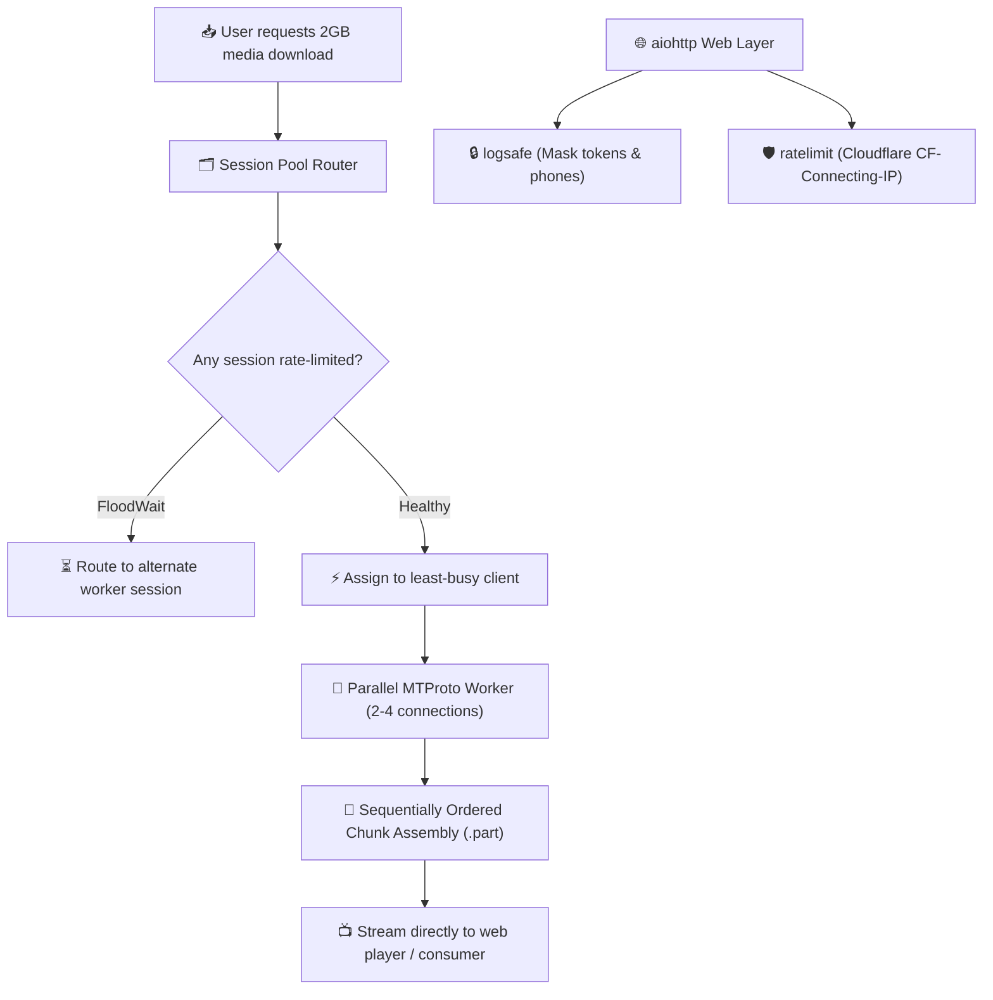

<div align="center">

# ⚡ tgmediakit
### Production-Grade Toolkit for High-Traffic Telegram Media Bots & MTProto Streaming

[](https://python.org)
[](https://github.com/Kaio-Comk/tgmediakit)
[](https://github.com/Kaio-Comk/tgmediakit)
[](https://github.com/Kaio-Comk/tgmediakit)
[](https://opensource.org/licenses/MIT)

**Battle-tested utilities for scaling Telegram bots handling gigabytes of media downloads.**  
*Multi-part parallel MTProto streaming, multi-session client pooling with FloodWait penalties, sliding-window rate limiters, and token-safe logging.*

[Modules](#-module-overview) • [How It Works](#-architecture) • [Installation](#-installation) • [Examples](#-module-walkthrough--examples) • [Contributing](#-contributing)

</div>

---

## 🌟 Module Overview

| Module | Core Purpose | Production Advantage |
|---|---|---|
| 🚀 **`parallel_download`** | Downloads large files over $N$ concurrent connections | Writes bytes in strict sequential order so you can **stream to users while downloading**. Handles file reference expiration automatically. |
| 🗂️ **`pool`** | Load balances across multiple Telethon sessions | Tracks dynamic `FloodWait` penalties per session and routes new jobs to the least-busy active account. |
| 🛡️ **`ratelimit`** | Sliding-window per-IP limiter with Cloudflare support | Extracts real client IP behind reverse proxies (never blindly trusts the first `X-Forwarded-For`). |
| 🔒 **`logsafe`** | Sanitizes server & HTTP access logs | Automatically redacts bot tokens, authorization headers, email addresses, and phone numbers from logs. |

---

## 🏗️ Architecture



---

## 📦 Installation

```bash
pip install git+https://github.com/Kaio-Comk/tgmediakit.git

# For aiohttp middleware & logging utilities:
pip install "aiohttp>=3.9"
```

---

## 💻 Module Walkthrough & Examples

### 1. Parallel MTProto Downloader
```python
from pathlib import Path
from tgmediakit.parallel_download import download_parallel

# Downloads document in ordered parallel chunks (up to 4x faster)
message = await client.get_messages(chat_id, ids=message_id)
await download_parallel(
    client=client,
    message=message,
    dest=Path("downloads/video.mp4"),
    connections=4
)
```

### 2. Multi-Session Client Pool (Flood-Wait Aware)
```python
from tgmediakit.pool import ClientPool

# Distribute requests across multiple Telegram user/bot sessions
pool = ClientPool([client1, client2, client3])

# Safely borrow the client with the lowest active load
async with pool.acquire() as active_client:
    await active_client.send_message(chat_id, "Processing...")
```

### 3. Cloudflare-Safe IP Rate Limiter
```python
from aiohttp import web
from tgmediakit.ratelimit import RateLimiter, create_ratelimit_middleware

limiter = RateLimiter(max_requests=60, window_seconds=60)
app = web.Application(middlewares=[create_ratelimit_middleware(limiter)])
```

### 4. Secret & Token Masking in Logs
```python
import logging
from tgmediakit.logsafe import SafeFormatter

# Attach formatter to protect your logs in production
handler = logging.StreamHandler()
handler.setFormatter(SafeFormatter("%(asctime)s - %(levelname)s - %(message)s"))
logging.getLogger().addHandler(handler)
```

---

## 🧪 Testing

```bash
pip install -e ".[dev]"
pytest -v
```

---

## 📄 License

Distributed under the **MIT License**. See `LICENSE` for details.

<div align="center">
  <sub>Built with ❤️ by Kaio Lima. If tgmediakit sped up your bot, please give it a ⭐!</sub>
</div>
